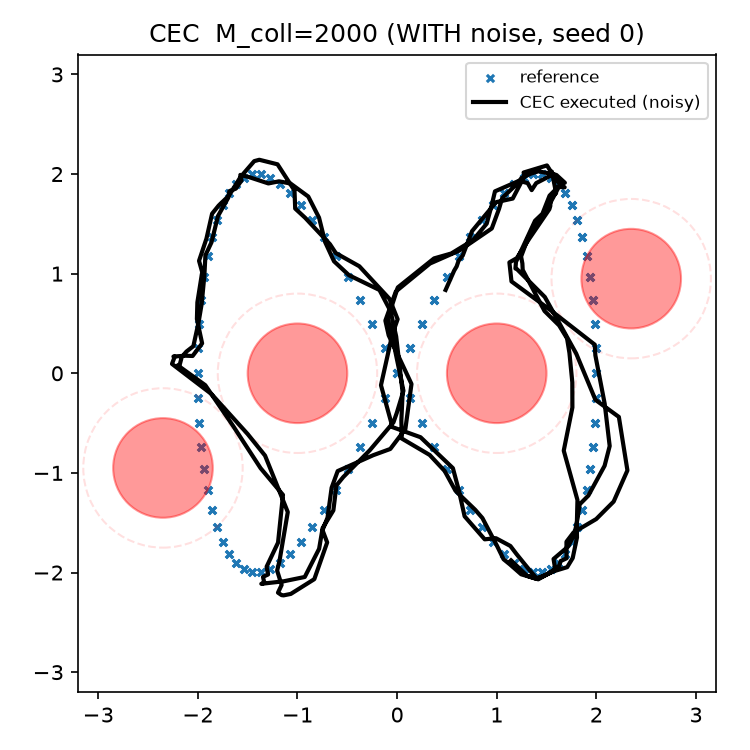
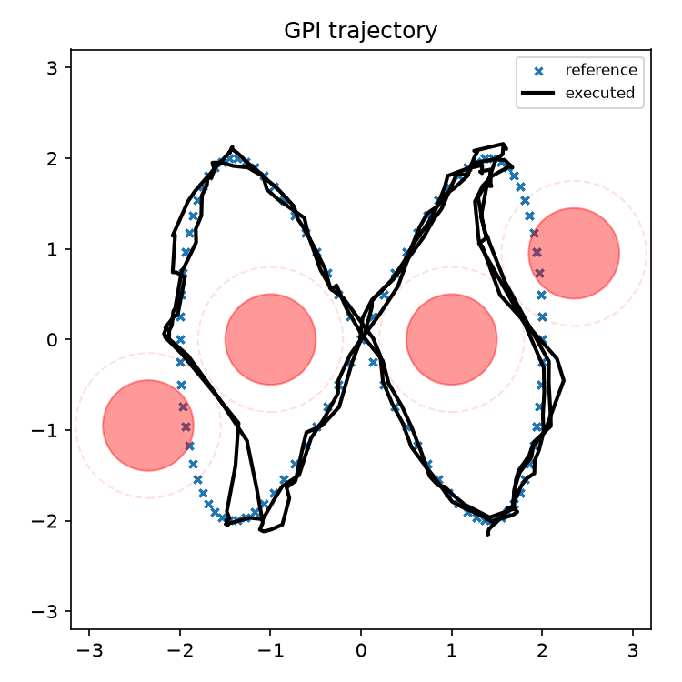
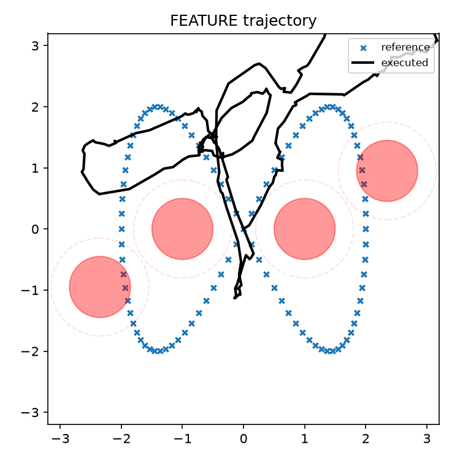
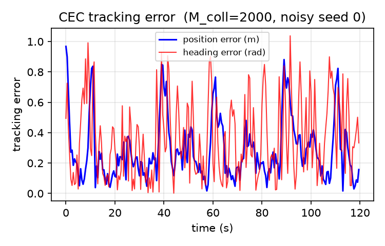
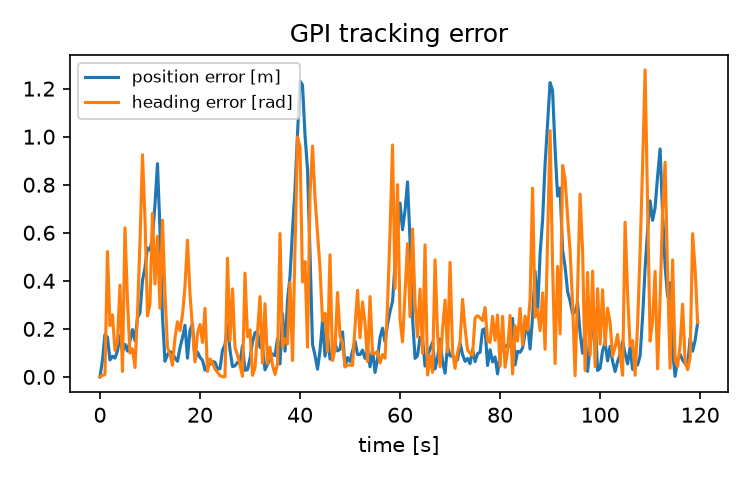
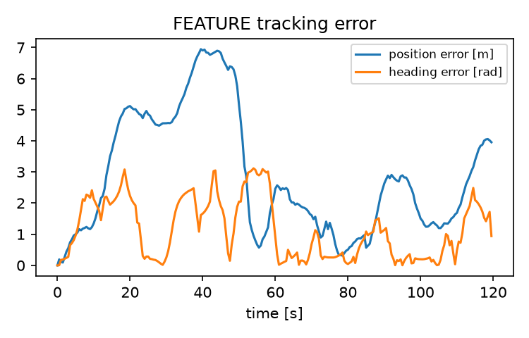

# Robot Trajectory Tracking under Uncertainty

**ECE 276B Project 3 · UC San Diego**

Comparing three control strategies for a noisy differential-drive robot following a figure-eight path around four obstacles.

<p align="center">
  
  
  
</p>
<p align="center"><em>Blue crosses: reference path · Black line: simulated robot path · Red: obstacles</em></p>

## What I built

| Controller | Approach | Practical trade-off |
| --- | --- | --- |
| Certainty-equivalent control (CEC) | Receding-horizon nonlinear optimization with CasADi/IPOPT | Tracks closely; solves an optimization problem at every step |
| Tabular generalized policy iteration (GPI) | Offline value iteration on a discretized state and action grid | Fast policy lookup after precomputation; limited by grid resolution |
| Feature-based GPI | Radial-basis value approximation fitted by ridge regression | Lower memory representation; more conservative behavior in this experiment |

I implemented the controllers, policy fitting, evaluation, and parameter studies on top of the ECE 276B course starter simulator. This repository contains the simulation and controller code needed for the comparison; it does not include the assignment handout or course assets.

## Results

Archived evaluation across **20 fixed noise seeds (0–19)**, using the same path, obstacle layout, and initial state for every controller:

| Metric | CEC | Tabular GPI | Feature GPI |
| --- | ---: | ---: | ---: |
| Mean RMS position error | **0.262 m** | 0.514 m | 3.912 m |
| Mean RMS heading error | **0.265 rad** | 0.485 rad | 1.823 rad |
| Runs without safety-radius intrusion | 0/20 | 0/20 | **15/20** |
| Mean online control time in the archived run | 28.50 ms | **0.02 ms** | 0.03 ms |

The evaluation defines a safety-radius intrusion as entering a **0.8 m** circle around an obstacle center; the drawn physical obstacle radius is **0.5 m**. The feature-based policy avoided the safety circles in 15 runs, but did so by drifting far from the reference path. CEC tracked most closely, yet entered a safety circle in every run. This is a simulation study, not a demonstration of reliable collision avoidance. Online timing is from the archived local run and will vary by machine; offline timing is omitted because the archived run mixed cached and newly built policies.

<details>
<summary>Tracking-error plots</summary>

| CEC | Tabular GPI | Feature GPI |
| --- | --- | --- |
|  |  |  |

</details>

## Run locally

Tested with Python 3.10, NumPy 1.26.4, and Matplotlib 3.9.0. The default simulator is NumPy based; MuJoCo is not required.

```bash
python -m venv .venv
# Activate the virtual environment for your shell, then:
python -m pip install -r requirements.txt
python src/main.py --controller cec --seed 0 --save
```

The saved trajectory appears in `results/`. Replace `cec` with `gpi`, `feature`, or `simple` to compare controllers. The first GPI run computes a policy before simulation; the original machine took about 12 minutes. Later runs load the policy cache from `src/gpi_out/`. Feature GPI likewise fits and caches its policy on first use. To display the animation instead, omit `--save`.

To reproduce the multi-seed evaluation and run the focused checks:

```bash
python src/main.py --experiments
python -m pytest -q src/tests
```

The evaluation writes plots to `results/` and a LaTeX-ready table to `results_table.txt`. Compute times depend strongly on CPU, installed numerical libraries, and whether a policy cache already exists.

## Repository map

```text
src/main.py            simulation entry point
src/cec.py             nonlinear receding-horizon controller
src/gpi.py             tabular stochastic dynamic programming
src/feature_gpi.py     feature-based policy iteration
src/value_function.py  grid and radial-basis value representations
src/evaluate.py        20-seed evaluation and figures
src/tests/             focused controller and value-function checks
images/                selected figures from the archived run
```

## Context

Course project: **UC San Diego ECE 276B, Project 3**. The reference simulator and parts of the scaffold were supplied by the course; the controller implementations and analysis were developed as coursework. The figures above report the recorded experiment, including its limitations. No license is asserted for the course-provided material.
